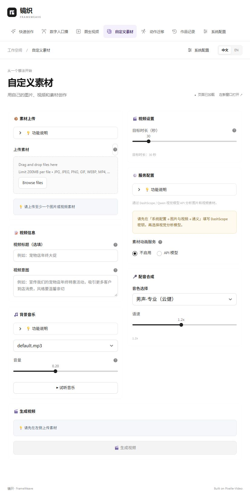

# 镜织 FrameWeave API 模式说明

当前 Web 工作台统一使用直接模型 API。功能说明核对至 2026-10-22；下方验收结果保留 2026-10-21 当次检查范围。

<!-- 维护说明：以下为当前产品入口能力，早期工作流调研与验收记录保留历史事实。 -->

## 当前入口

| 页面 | 实际使用的服务 |
| --- | --- |
| 快速创作 | 文案 API、图片或文生视频 API、在线 Edge TTS、本地 FFmpeg 合成 |
| 数字人口播 | 支持人物参考图和参考声音的 API；当前为 Wan `wan2.7-r2v` |
| 图生视频 | 支持首帧或参考图片的视频 API，保留 Grok / Muse 等已接入选项 |
| 自定义素材 | OpenAI / 兼容视觉接口或 DashScope / Qwen 素材分析、文案 API、在线 Edge TTS、可选图生视频 API |
| 动作迁移 | 支持参考视频与人物图片的编辑 API，当前为 Wan / HappyHorse 对应视频编辑模型 |
| 系统配置 | 文本模型、图片与视频、网络与调试三类；保存 API 凭据和地址 |

数字人参考声音用于音色与口播参考，不保证逐字复现音频或精确口型同步。普通文生 / 图生视频 API 不能代替此能力；当前 Grok / Muse 不放入数字人或动作迁移列表。以上为本地已接入的接口能力，不代表所有中转服务均实现对应协议，也不是实时账户权限验证。

## 移除与兼容

- 删除各创作页的版本信息 / Stars 卡片。
- 当前 Web 页面不再提供 RunningHub、本地 ComfyUI 的来源选择、配置输入及工作流回退。
- 数字人原前置图片工作流选择不适用于直接参考图 API，已撤下；人物 / 商品素材、文案、模型参数和结果仍保留。
- 配音内部兼容枚举 `local` 代表在线 Edge TTS，不是离线模型。各 Web 生成入口显式传递此模式，旧配置不能重新启用工作流配音。
- 删除旧选择或模型目录为空时，明确提示并禁用生成；静态模板不强制选择不需要的媒体模型。
- 保存与恢复当前 API 设置均保留历史工作流配置段；不改写用户已保存的旧凭据。上游核心的兼容代码仍保留供原命令行使用，不作为当前 Web 功能提供。
- 新 API / LLM 配置在创作页下次重渲染时重新载入服务实例。外层切换标签只保留页面；保存后可通过上一步 / 下一步触发重绘，避免刷新整页丢失草稿。
- 文本与视觉模型读取对应服务已保存的目录；媒体生成还要求已实现的能力适配。自定义素材第二步可直接加载并保存视觉目录，然后明确选择支持图片输入的模型。

## 2026-10-21 历史验证结果

- 本地浏览器逐项检查快速创作、数字人口播、图生视频、自定义素材、动作迁移、系统配置：页面加载正常，未出现版本卡或旧来源选项。
- 数字人页面实际显示 API 口播模型及参考声音限制；设置显示三类分组。
- `pytest tests -q`：212 项测试、212 个子测试通过；13 条既有 locale 弃用警告。
- TypeScript 检查、Vite 生产构建通过；本轮改动文件的 Ruff 检查通过。
- 新离线测试覆盖旧会话迁移、模型能力过滤、空目录禁用、单条与批量提交拦截、素材后端无工作流回退、API 配置刷新、保存时保留历史配置。
- 未读取或改写真实密钥配置；未提交实际模型生成、配音或人物素材上传。离线测试不代表供应商生成已验收。

## 参考与致谢

本项目基于 [Pixelle-Video](https://github.com/ATH-MaaS/Pixelle-Video) 二次开发，感谢原作者与社区提供的开源基础。
