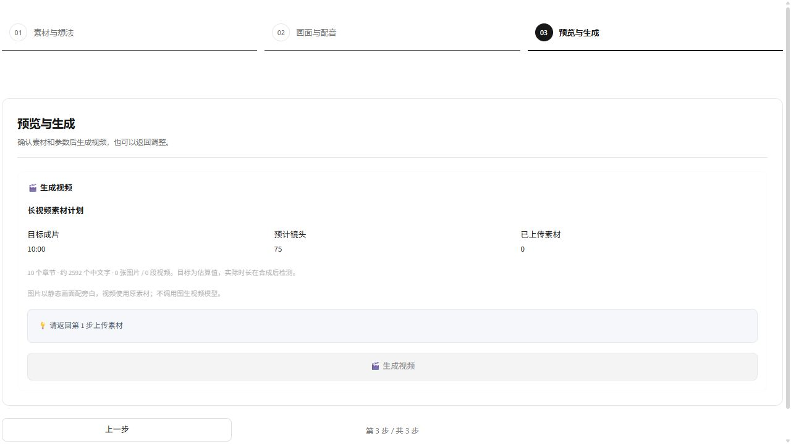
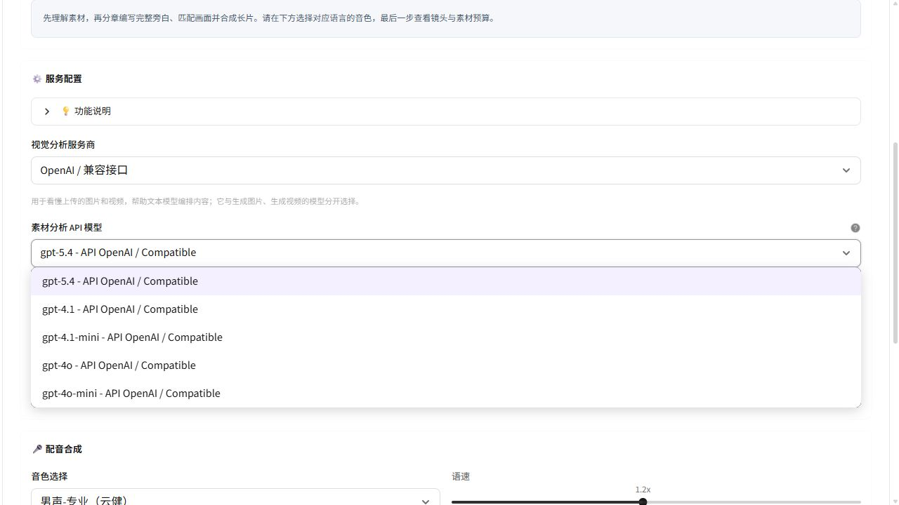
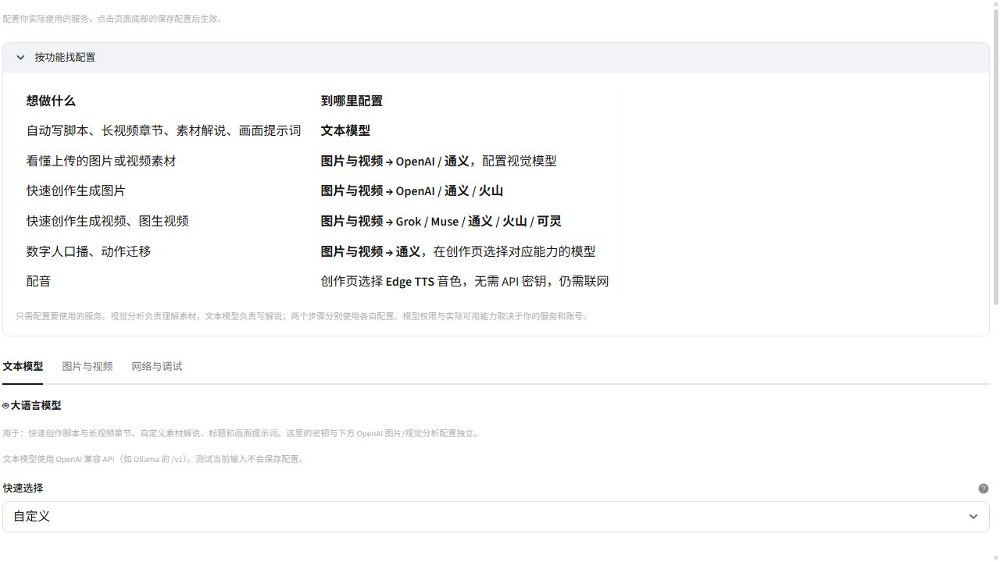

# 自定义素材长视频与视觉模型接入

<!-- 本记录区分本地代码、离线媒体验证和实际供应商调用，不把预算写成实测结果。 -->

日期：2026-10-21。范围：保留镜织现有五类创作页面，增强自定义素材流程与配置说明。

## 使用入口

1. 自定义素材 → 素材与想法：上传自己的图片或视频，填写内容方向。
2. 画面与配音：选择“长视频 · 5–10 分钟”，目标可选 5、8、10 分钟；选择旁白语言、音色、语速、视觉分析服务商与模型。
3. 预览与生成：查看目标时长、章节数、镜头数、旁白预算及素材数量，确认后才调用模型。

系统配置 → “按功能找配置”提供用途表；图片与视频页按平台分组，每组注明用于图片、视频、素材理解或数字人等哪些功能。OpenAI 与通义均可填写每行一个的自定义视觉模型名，追加到内置目录。保存配置后回到创作页选择。文本模型使用自己的配置，不自动借用媒体服务的密钥。

## 已实现行为

- 5 / 8 / 10 分钟分别规划约 38 / 60 / 75 个镜头。根据中文或英文、当前配音速度估算旁白量，先生成大纲再逐章生成；章数、旁白量和素材路径校验通过后才开始配音。
- 长片只使用成功分析的素材，分析失败项会排除并提示数量；全部失败则停止。未知素材路径或截断的章节不会被当作成功脚本。
- 复用同一视频时按时间均匀取不同窗口，窗口长度按真实旁白时长确定；源视频过短时循环画面。原素材不修改，原音轨不混入旁白成片。
- 保存章节脚本、素材引用情况和取段信息。最终探测成片实际时长并显示偏差；无法探测则明确标为不可用，不把预算当成实测。当前不支持中断后的断点续生成。
- 单视频上传上限 1 GB。视觉图片限制为 32 MB、6400 万像素，发送前缩放。预览默认收起，每页最多 9 项；同一 Streamlit 上传身份在切换步骤时复用缓存，避免重复读取和计算整份文件摘要。
- OpenAI / 兼容接口使用 Chat Completions 图片输入；通义使用原生多模态接口。两者分别使用各自的地址、密钥和显式代理，不跨服务借用配置。
- 视频在本地均匀采样最多 8 / 16 / 32 帧，附采样时间再发送视觉分析；不会将整个视频当作图片上传。临时帧在成功或异常后清理，网络错误不回显密钥和响应正文。

## 验证记录

- 完整离线回归：312 项测试、469 个子测试通过；3 项显式媒体冒烟默认跳过。存在 29 条既有 locale 弃用提示。
- 最后调整上传提示与章节进度后，素材界面相关 9 项测试、3 个子测试通过；Ruff 通过。
- 独立开启视觉媒体冒烟：真实生成 600 秒低清色块视频，采样 16 帧成功，结束后临时帧目录清理。整个测试没有调用云模型。
- 独立开启视频取段冒烟：用带声音的红蓝色块源验证不同时间窗口、短源循环、移除源音轨、实际片段时长和原文件哈希不变。
- 模拟完整 10 分钟素材流程，验证 75 个镜头、语速传递、实测结果和历史保存；此处模型与最终时长探测使用测试替身，不代表真实 AI 长片质量。
- TypeScript 检查、Vite 生产构建通过；Git 空白检查通过。中文文件以 UTF-8 保存。
- 本地创作服务重启后完成实际浏览器检查：1 GB 上传提示、5/8/10 分钟选项、OpenAI 模型目录、长片计划、无素材阻断、配置用途表、自定义模型输入均存在。

## 当前边界

目标时长由旁白量和语速估算，不保证精确到秒。素材不足时可能复用画面；均匀取段不是根据旁白语义定位事件，抽帧分析也可能漏掉短暂动作，不包含音频识别。图片动画只有另行启用才调用图生视频模型。

没有使用用户的真实素材、供应商密钥或配音接口生成完整长片，没有修改用户保存的 API 设置。离线测试及页面检查不代表中转站已支持某个模型；实际服务必须支持所选协议和图片输入。

接口依据：[OpenAI 图像输入](https://developers.openai.com/api/docs/guides/images-vision)、[DashScope 视觉理解](https://help.aliyun.com/zh/model-studio/vision)。
