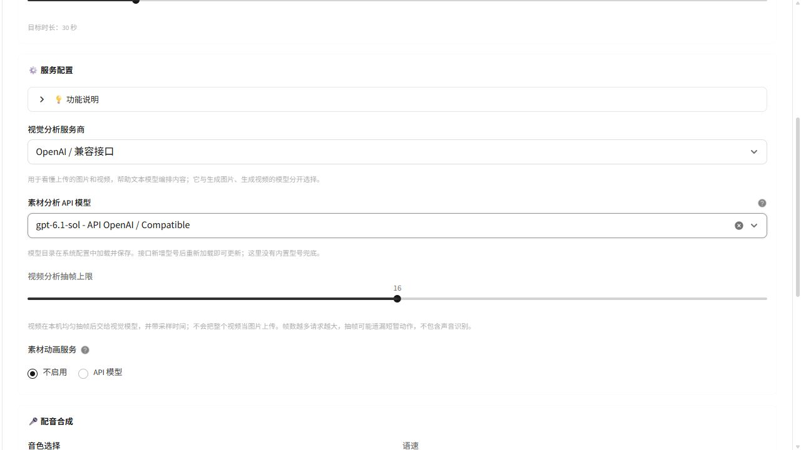

# 镜织 FrameWeave 动态模型目录

<!-- 目录查询与生成能力是不同验证层；本说明不声称真实云端生成通过。 -->

模型下拉不再由固定的型号表填充。先进入系统配置，填写对应服务的地址与凭据，加载模型，再保存配置。创作页面读取这份目录；接口增加文本或视觉型号后，重新加载并保存即可更新选项。

## 各入口的来源

| 入口 | 下拉内容 |
| --- | --- |
| 文本模型 | 当前文本接口加载的模型 ID；手工模型名为独立输入方式 |
| 自定义素材：视觉分析 | OpenAI 或通义当前连接的已保存目录，按提供商分别选择 |
| 快速创作：图片 / 视频 | 当前提供商目录中已经适配所选媒体类型的型号 |
| 图生视频、素材动画 | 当前提供商目录中已适配首帧图生视频的型号 |
| 数字人口播、动作迁移 | 当前提供商目录中已适配相应输入与任务协议的型号 |

接口通常只返回名称。出现在列表里不证明支持图片输入、账号有生成权限或余额足够。视觉分析需要选择图片输入型号。图片和视频仍需已有适配器处理任务提交、轮询和下载，不能把未知协议自动当作可用能力。

## 加载、保存与失效

- 支持文本兼容接口、OpenAI、通义、Grok、Muse 的目录查询，使用当前填写的地址与凭据，不借用其他服务的密钥。
- 加载结果直接形成目录，无需再次“多选并加入内置列表”。统一保存后才供其他创作页使用。
- 目录保存连接指纹及来源、加载时间。修改地址、密钥或启用的代理后，原目录失效，不能通过再次保存把旧目录绑定到新连接。
- 刷新返回空目录或失败时，清除当前目录候选，不退回固定型号。未加载时提示先到设置加载并保存。
- 保存后重启仍能读取目录。服务返回新的 ID 时，重新加载会替换旧目录，避免已删除模型继续残留。
- 对不提供模型目录查询的接口，可以明确选择手动维护。ARK / Kling 当前没有已接入的目录查询接口，使用这一方式；界面显示“手动”来源，不表示查询成功。
- 旧 `vision_models` 配置保留为历史手填数据，不再自动并入接口目录。服务预设可以提供地址，不能作为接口模型列表的来源。

## 已配置却提示无法生成

<!-- 文本接口目录和素材视觉接口目录分别保存，不能用另一服务的列表或凭据消除拦截。 -->

文本模型、图片生成与素材视觉分析是不同用途。文本模型已加载，并不表示素材分析的目录也已保存。如果 OpenAI / 通义的地址和密钥已经填写，可在「自定义素材 → 画面与配音」选择对应视觉服务，点击「加载并保存模型列表」，然后明确选择支持图片输入的模型。这个按钮只查询模型名称，不上传素材，也不提交生成任务。

生成页分别说明缺少视觉配置、缺少有效目录、尚未选择模型的情况，并提供返回模型选择步骤的入口。步骤切换和加载目录保留当前素材与草稿；加载失败或接口返回空列表时继续阻止生成。目录中的审查、音频、图片生成等型号不自动作为视觉模型选中。

## 验证范围

离线测试使用虚构模型名、内存配置和模拟响应，验证目录加载、保存、连接变更失效、空目录阻止生成，以及同名模型按提供商隔离。测试不读取用户密钥，也不调用付费生成接口。

2026-10-21 修复素材分析目录阻断后，全量回归：381 项测试及 562 个子测试通过，3 项跳过，29 条既有警告。包含真实设置控件加载 → 内存保存 → 真实素材模型服务读取、素材页直接加载保存、明确选择型号、返回保留草稿，以及旧设置页不覆盖其他页面新目录的往返测试。

本轮无需重启服务。浏览器使用已配置的视觉接口加载并保存了 26 个模型，确认实际下拉包含并可选择 `gpt-6.1-sol`。配置摘要校验确认仅 OpenAI 的 `model_catalog` 改变，其他配置保持一致。没有上传素材、提交视觉分析、配音或视频生成请求，因此这里仅确认模型目录与表单校验，不表示已验证转发服务的图片输入能力或视频生成成功。

