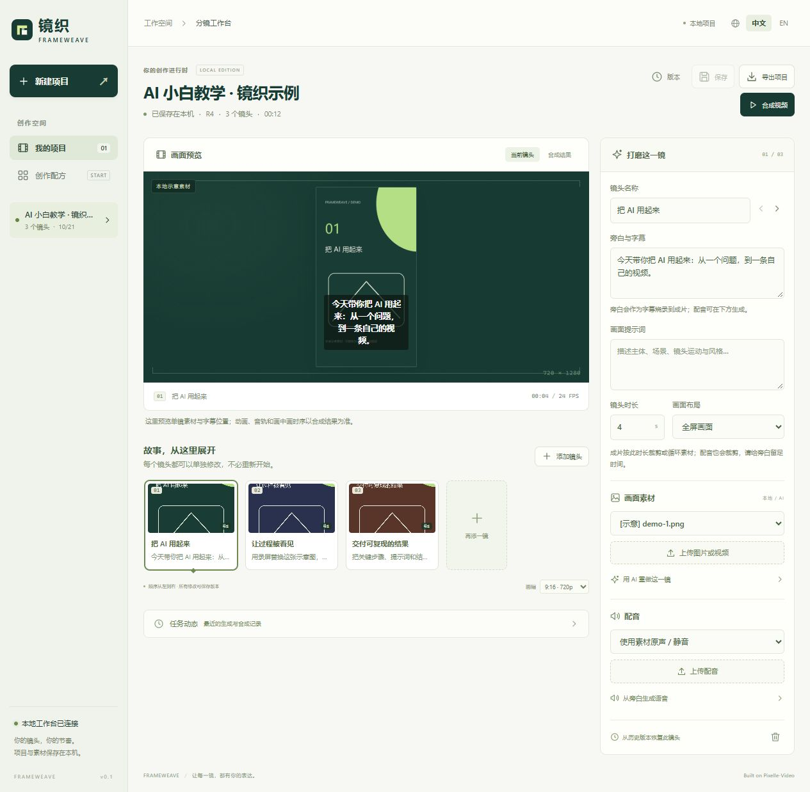
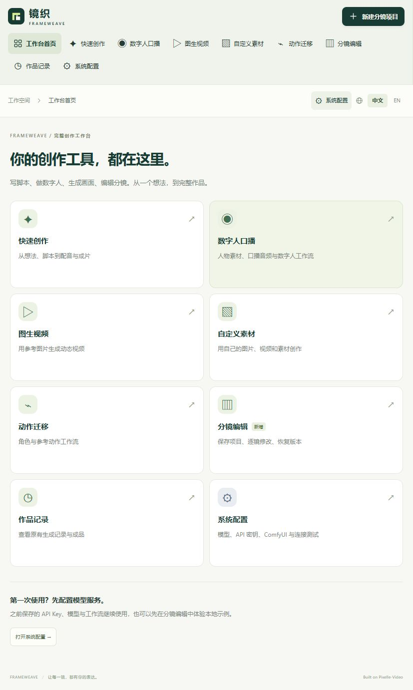
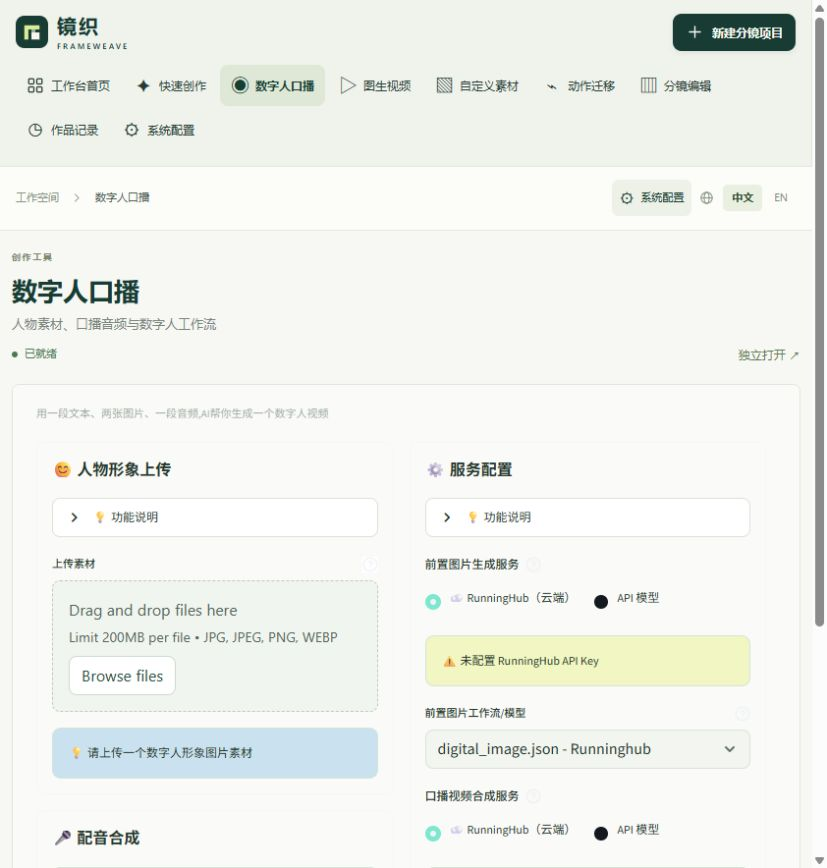
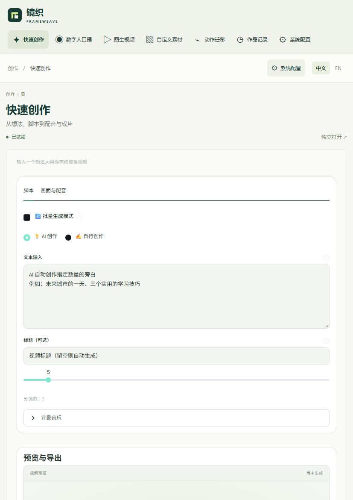

# 镜织 FrameWeave v0.1 本地验收

<!-- 本记录区分代码验证、本地运行和外部服务验收，不将模拟响应称为模型实测。 -->

> 最新范围调整（2026-10-21）：按用户要求，分镜编辑已退出当前界面，默认进入原有快速创作。下文的项目、版本、单镜编辑等记录属于此前实验的历史验收，不代表当前对外功能；本轮结果见文末“移除分镜编辑”。

> 后续同日完成的纯白 UI、ComfyUI 诊断和数字人阶段反馈，见[独立验收记录](white-ui-validation-2026-10-21.md)。

日期：2026-10-21。环境：Windows、Python 3.11、FFmpeg/ffprobe。验收使用临时数据目录和程序绘制的示意素材，不使用个人肖像，不触发付费模型生成。

前端使用 Codex 内置 Node 24 完成构建与 Prettier 格式检查。当前系统默认 Node 16 不满足 Vite 要求，重新构建时请按 README 安装 Node 22 或更新的受支持版本；运行已经构建好的工作台不需要 Node。

## 已完成的代码与离线验证

| 项目 | 结果 | 范围 |
| --- | --- | --- |
| 全量 Python 测试 | 160 项测试、162 个子测试通过 | 包含原有测试、分镜模块、完整工作台路由与统一启动器 |
| 新模块静态检查 | Ruff 通过 | `frameweave/` 及新增测试 |
| 前端构建 | TypeScript、Vite 生产构建通过 | `studio/dist` 可由本地 API 服务提供 |
| 真实视频合成 | 通过 | 混合镜头、中文字层、矩形画中画与视频原音；检查 MP4 的时长、尺寸和音频流 |
| 项目完整流程 | 通过 | 创建配方 → 修改并排序 → 保存 → 真实合成 → 下载视频/ZIP → 恢复版本 → 新服务实例读取 |
| 并发编辑 | 通过 | 错误 revision 返回 409；迟到的生成结果不覆盖新编辑 |
| 持久任务 | 通过 | 重启把运行中任务标为中断；本地合成取消后可处理下一任务 |
| 文件输入 | 通过 | 拒绝伪装素材、跨项目引用和不支持的播放列表；检查 ZIP 相对路径 |
| 模型桥接 | 隔离测试通过 | 只改选中镜头、生成前重载最新配置、禁止自动改写后再次提交、错误不回传密钥 |

原测试存在 `locale.getdefaultlocale` 的弃用提示，未影响本轮通过结果。没有为本次功能扩大修改旧国际化模块。

## 浏览器验收

已在本地真实页面完成以下操作，不只是静态截图：

1. 选择教学配方，创建「AI 小白教学 · 镜织示例」，修改项目名称和第一镜头旁白并保存。
2. 在右上角切换中文与 English，再切回中文；检查浏览器无 error 级日志。
3. 点击合成，观察持久作业由排队到完成，项目产生新版本 R4。
4. 在页面播放成片，视频为 720×1280、12.021 秒，播放器有实际播放进度，`video.error` 为空。
5. 检查 390×844 移动视口，页面无横向溢出；恢复桌面中文编辑态。



## 运行与发布边界

- 新工作台入口：`python -m frameweave`，默认 `http://127.0.0.1:8765`。
- 本轮最后补充的图片参考图参数已通过离线测试；当前预览进程还需重启以加载这一最终 Python 修改。
- 后续完整工作台修复已把原有创作、数字人和系统配置纳入同一导航。其内部 Streamlit 服务使用 `8501`，统一启动命令自动复用或启动；生成时重载已保存的模型配置。下方记录的首次浏览器验收仍只覆盖当时的分镜模块，不代表原有功能已原生迁移到 React。
- 真实云端视频、图片和 Edge TTS 本轮未发起，不把模拟接口通过解释为供应商可用性确认。
- 新增 GitHub Actions 离线工作流已写入；尚未推送或在 GitHub 执行。
- 未验证 Linux/macOS 的实际安装过程，未发布安装包或 Docker 镜像。

## 重现检查

```bash
uv sync --extra dev
uv run python -m pytest tests -q
uv run python -m ruff check frameweave tests/frameweave_engine_test.py tests/frameweave_workflow_test.py tests/frameweave_api_test.py tests/frameweave_store_test.py
npm --prefix studio ci
npm --prefix studio run build
```

本地图片、数据库、日志与合成视频保存在被 Git 忽略的数据目录；README 截图只使用本地示意项目。

## 完整工作台修复：启动器离线验证

`tests/frameweave_launcher_test.py` 新增 18 项测试通过，启动器与测试的 Ruff 检查通过。覆盖已有 Streamlit 与本仓库身份识别、其他项目拒绝复用、进程权限受限、错误监听 PID、未知端口占用、隐藏启动参数、子进程失败与超时、只清理自有子进程以及主服务生命周期。网络与进程均使用模拟对象；验证期间未启动、重启或停止任何现有服务，未调用生成模型。

只读检查确认当前旧 Streamlit 使用相对脚本路径，无法通过新的 Windows 绝对路径归属校验，现有浏览器功能不受此检查影响。下一次运行统一启动器时，如果旧进程仍在，会提示无法确认归属；启动器不会擅自结束它。详细操作见下方统一工作台说明。

完整工作台调整原因与启动行为见[统一工作台说明](frameweave-unified-workspace.md)。自动启动器需在下次正常启动时加载，不能把修改源码当作正在运行的 Python 服务已生效。

## 完整工作台修复：浏览器验收

本轮在用户当前的 `http://127.0.0.1:8765/` 页面完成以下检查：

- 逐项打开快速创作、数字人口播、图生视频、自定义素材、动作迁移与作品记录，均收到原页面渲染完成的就绪通知，并检查真实表单内容。
- 系统配置呈现原有四类设置及保存入口，沿用原组件；未修改或提交真实密钥。配置标签内部的点击在当前浏览器自动化中受限，保存和分组行为由隔离的 Streamlit AppTest 覆盖，不声称已逐项手动保存。
- 数字人口播输入临时测试文案，切到系统配置再返回，文案保留；验收后已清空测试文字。
- 分镜编辑仍可打开已有项目及三个镜头。作品记录新增“刷新列表”，新增记录读取和筛选保持由 AppTest 验证，浏览器确认按钮可见。
- 在当前约 842 px 宽的浏览器中，导航自动换行显示全部功能，系统配置和中英切换仍在右上角；内嵌原页面改为配套浅色表单。
- TypeScript、Vite 生产构建与新增前端文件的 Prettier 检查通过；本轮全仓 Python 结果为 160 passed、162 subtests passed。

本轮只验证功能恢复和本地交互，没有提交真实视频、图片、数字人口型或语音生成。原流程的模型、工作流和服务配置要求保持不变。





## 移除分镜编辑：只优化原有功能

按用户明确要求，当前前端删除了分镜编辑组件、新建项目、项目列表、版本恢复、配方和相关 API 请求及轮询逻辑；不是把编辑器继续挂在隐藏区域。导航保留原有五个创作流程、作品记录、系统配置。旧 `#storyboard`、`#home` 或无效地址统一进入 `#standard`。历史数据文件未删除，存量实验代码和历史验收记录不作为当前产品功能介绍。

本轮验证：

- 用户当前浏览器由旧分镜地址刷新后进入快速创作；检查分镜编辑、新建分镜、切换项目、版本恢复按钮数量为零。
- 打开数字人口播与系统配置，确认原表单、四类设置和保存入口保留；右上角中英界面切换正常。
- 前端 TypeScript、Vite 生产构建及修改文件的格式检查通过。
- 复用原有回归测试：工作台路由 8 项和 5 个子测试、原创作界面 10 项和 6 个子测试通过。
- 未提交视频、数字人或语音生成，未修改真实密钥、模型配置及历史作品。


