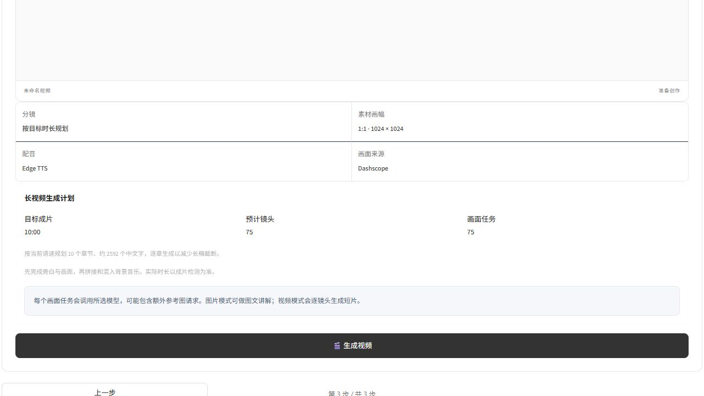
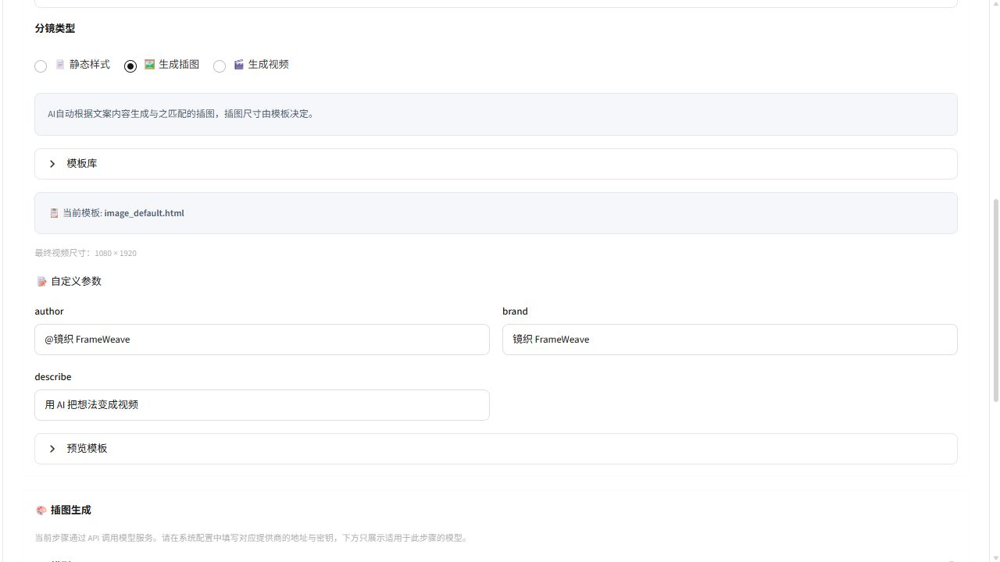

# 长视频与模板品牌更新 · 2026-10-21

<!-- 本记录分别描述代码、本地媒体合成、真实页面与云端验收，避免把离线替身当成 AI 成片。 -->

## 当前用法

在快速创作第 1 步选择「长视频 · 5–10 分钟」，选择 5、8 或 10 分钟及旁白语言。AI 创作输入主题，自行创作输入完整稿件。第 2 步沿用现有模板、API 画面、音色、语速和背景音乐设置；第 3 步查看计划后提交。

长片使用多个镜头合成完整视频：规划章节 → 逐章生成并校验完整旁白 → 逐镜头生成配音和画面 → 统一编码并拼接 → 混入背景音乐 → 检测最终文件时长。模型的单次视频时长上限保持不变。

| 中文旁白，1.0 倍速 | 5 分钟 | 8 分钟 | 10 分钟 |
| --- | ---: | ---: | ---: |
| 章节 | 5 | 8 | 10 |
| 预计镜头 | 38 | 60 | 75 |
| 文案预算（字） | 1080 | 1728 | 2160 |

文案预算会随语速变化。实际浏览器检查中，10 分钟、1.2 倍速显示 10 章 / 75 镜 / 2592 字。图片 / 视频模板按镜头规划画面任务；静态模板不产生媒体生成请求。画面任务数不是精确计费次数，额外参考图和重试可能增加模型请求。

自行创作只拆分长段落，保留原稿，不自动扩写或重复内容。目标与原稿预计长度相差较大时会提示，仍允许按原稿生成。

## 实现与边界

- `pixelle_video/utils/long_video.py` 为前后端共享预算与章节脚本逻辑；脚本格式、章节数量、单镜头字数和章节总字数均校验，每章不达标最多修订一次。完整脚本未通过前不调用配音或画面生成。
- `pixelle_video/pipelines/standard.py` 保留短片原路径，长片使用 `target_duration_seconds`、`narration_language`，语速始终显式传入 TTS。完成的文字与预算保存到任务目录的 `long-video-script.json`。
- `frame_processor.py` 保留旁白时长，避免被云端短片覆盖；各分镜统一 FPS、YUV420 和 AAC 48 kHz 双声道，最终文件通过 FFprobe 测量。短于旁白的素材保留现有末帧停留处理，不拉慢整片。
- 结果和历史元数据保存目标与实测差值。偏差超过目标的 15% 显示提示；检测失败标记 `unavailable`，界面不声称已达目标。
- 当前入口只用于单条快速创作，原四种素材工具和批量流程保留。尚未实现长片自动断点续生成。分钟数是规划目标，不能保证每种音色、标点和数字读法都精确达到目标。

## 模板品牌

22 个带旧品牌默认值的内置模板已更新：`author` / `signature` 为 `@镜织 FrameWeave`，`brand` 为 `镜织 FrameWeave`，`describe` 为 `用 AI 把想法变成视频`。支持填写自己的品牌文字。

旧默认会话缓存仅精准迁移一次，用户自定义内容保留。三个浏览器页面标题与中英文产品 / 预览文案同步更新。上游许可证和署名保留。

图库优先使用 `docs/images/frameweave/`：31 个模板、62 张中英文 PNG，总计约 8.3 MB。使用现有 HTML 模板渲染器按半倍率离线重建；网络图片和字体请求被阻断，未调用生成模型。旧图库与用户自定义模板不覆盖。

```bash
uv run python docs/rebuild_template_previews.py
```

## 验收

- 全量离线回归：273 passed、426 subtests passed；1 项显式开启的媒体验收默认跳过，另行运行通过。29 条警告来自已有 `locale.getdefaultlocale` 弃用提示。
- 浏览器：独立本地会话检查三步表单，选择 10 分钟后进入第 3 步，显示 75 镜与当前语速对应的预算；检查模板作者、品牌、标语及新版图库。没有点击生成视频、TTS 试听或模型预览。
- 前端：TypeScript 与 Vite 生产构建通过。
- 静态检查：本轮长片组件、规划器、测试和模板重建脚本 Ruff 通过。
- 离线媒体：使用 160×90、2 FPS 色块和静音，交替拼接来自图片与不同原始帧率视频的分镜。60 / 120 个五秒片段分别实测 300.021 / 600.021 秒，音视频轨道尾部完整。临时文件自动清理，不作为用户作品或 AI 效果展示。
- 云端：本轮没有调用真实 LLM、视频模型或 TTS，尚未进行真实 API 的 5–10 分钟成片验收。

常规回归：

```bash
uv run python -m pytest -q
```

可选离线媒体冒烟，需要 `ffmpeg` 与 `ffprobe` 在 PATH（PowerShell）：

```powershell
$env:FRAMEWEAVE_MEDIA_SMOKE = '1'
uv run python -m pytest tests/long_video_timing_test.py -q
Remove-Item Env:FRAMEWEAVE_MEDIA_SMOKE
```




