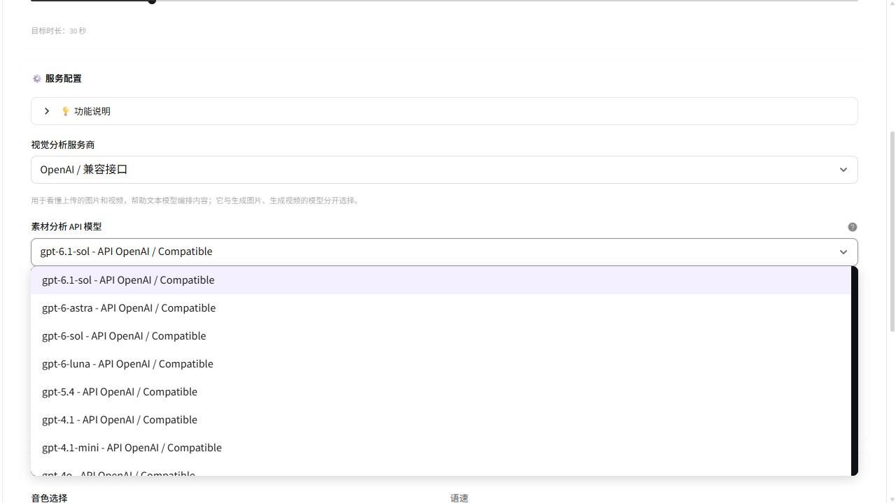

# 镜织 FrameWeave 模型下拉目录审计

> 本文保留同日早一版的审计记录；其中“内置候选”“多选加入视觉列表”已被后续改动替换。当前所有模型下拉以已保存的连接目录为来源，详见[动态模型目录说明](dynamic-model-catalog.md)。下文固定数量仅表示当时的协议注册项，不再表示页面会自动展示这些型号。

<!-- 维护说明：此文档是 2026-10-21 本地代码目录快照。更新型号或适配器时重新核对数量与能力，不据此宣称云服务已实测可用。 -->

审计日期：2026-10-21（北京时间）。范围为快速创作、图生视频、数字人口播、动作迁移、自定义素材、系统设置中的模型选择与配置刷新。

本轮读取代码并执行离线测试，没有读取或展示真实配置密钥，没有调用真实云模型、上传用户素材或生成付费内容。下文“候选数量”是本项目代码可展示的内置目录数量，不是账号已开通数量、官方全部型号，也不代表这些型号全部为最新版本。中转服务是否接受某个名称，仍取决于其实际模型映射与 API 协议。

## 目录来源与筛选总表

| 页面 / 入口 | 数据源 | 筛选条件 | 本轮内置候选数量 | 配置与刷新行为 |
| --- | --- | --- | --- | --- |
| 快速创作：图片模板 | `APIProviderMediaService.IMAGE_MODELS` | `media_type=image`；仅 `api/` 来源 | 7 | 每次渲染读取本地注册表；不是接口自动发现的目录 |
| 快速创作：视频模板 | `VIDEO_MODELS` 与 `VIDEO_MODEL_CAPABILITIES` | `text_to_video`，且契约标记已确认 | 11 | 模板类型改变后重新筛选，失效选择会清除 |
| 图生视频 | 同上 | `first_frame_i2v`，且契约标记已确认 | 12 | 提交前再次核对模型仍在兼容目录 |
| 数字人口播 | 同上 | `digital_human`、`voice_reference`，适配器输入同时包含图片和音频 | 1 | 普通图生视频与仅支持原生声音输出的型号不自动入选 |
| 动作迁移 | 同上 | `action_transfer`，且契约标记已确认 | 2 | 提交前再次核对动作迁移能力 |
| 自定义素材：图片动画 | 同上 | `first_frame_i2v`，且契约标记已确认 | 12 | 用户选择开启图片动画后才使用；默认静态图片不调用图生视频 |
| 自定义素材：视觉分析服务商 | `APIAssetAnalysisService.VLM_MODELS` | 按服务商分组 | 2 | OpenAI / 兼容接口、通义 / DashScope，分别使用各自凭据 |
| 自定义素材：视觉分析型号 | 视觉内置目录 + 已保存的 `vision_models` | 所选服务商；另提供临时手填入口 | OpenAI 9、通义 4；共 13 个内置型号 | 自定义项去重后追加；页面显示未配置提示，未配置时阻止提交 |
| 系统设置：文本服务预设 | `pixelle_video/llm_presets.py` | 服务预设，不做模型能力探测 | 6 个服务预设 + 自定义 | 切换预设填入其默认地址 / 型号；保留手工模型名 |
| 系统设置：文本型号 | 自定义入口、OpenAI 参考候选、当前接口查询结果、已有选择 | OpenAI 参考候选只加入 OpenAI / 自定义预设 | 动态，无固定数量 | 目录缓存绑定预设、地址、密钥；变化后清除旧查询结果 |
| 系统设置：视觉型号候选 | 用户点击“从接口加载模型”后的接口结果 | 只作为待选择候选，不推断视觉能力 | 动态，无固定数量 | 先加入自定义视觉列表，统一保存后在创作页生效 |

图片 / 视频总注册表包含 7 个图片型号与 20 个视频型号。不同页面只显示其中适用的子集，因此页面数量不能直接相加。`seedance-1-0-pro`、`seedance-1-0-lite` 的本地契约标记未确认，不进入要求确认契约的视频选择器。`happyhorse-1.0-r2v` 虽在视频目录内，但没有当前口播流程需要的参考声音输入，因此不进入数字人口播下拉。

## 各创作页的内置型号

### 快速创作：图片，共 7 个

| 服务分组 | 型号 |
| --- | --- |
| 通义 / DashScope | `wan2.7-image`、`wan2.7-image-pro`、`wan2.6-t2i` |
| OpenAI | `gpt-image-2` |
| 火山 / Seedream | `doubao-seedream-5-0-260128`、`doubao-seedream-4-5-251128`、`doubao-seedream-4-0-250828` |

### 快速创作：视频，共 11 个

| 服务分组 | 型号 |
| --- | --- |
| 通义 / DashScope | `wan2.7-t2v`、`happyhorse-1.0-t2v` |
| 可灵 / Kling | `kling-v3`、`kling-v2-6`、`kling-v2-5-turbo` |
| 火山 / Seedance | `doubao-seedance-2-0-260128`、`doubao-seedance-2-0-fast-260128` |
| xAI / Grok | `grok-imagine-video-1.5`、`grok-imagine-video-1.5-lite`、`grok-imagine-video` |
| Meta Muse / muse2api | `muse-video` |

### 图生视频与自定义素材图片动画，各 12 个

| 服务分组 | 型号 |
| --- | --- |
| 通义 / DashScope | `wan2.7-i2v`、`wan2.6-i2v-flash`、`happyhorse-1.0-i2v` |
| 可灵 / Kling | `kling-v3`、`kling-v2-6`、`kling-v2-5-turbo` |
| 火山 / Seedance | `doubao-seedance-2-0-260128`、`doubao-seedance-2-0-fast-260128` |
| xAI / Grok | `grok-imagine-video-1.5`、`grok-imagine-video-1.5-lite`、`grok-imagine-video` |
| Meta Muse / muse2api | `muse-video` |

### 数字人口播与动作迁移

| 页面 | 型号 | 当前接入范围 |
| --- | --- | --- |
| 数字人口播 | `wan2.7-r2v` | 图片参考与参考声音；不保证逐字复现或精确口型同步 |
| 动作迁移 | `wan2.7-videoedit`、`happyhorse-1.0-video-edit` | 参考视频与图片输入，使用已接入的视频编辑协议 |

Seedream 与 Seedance 在界面中属于火山服务，凭据使用 ARK 配置。模型的展示分组名与代码中的适配器名称不必完全相同。

## 视觉分析与 GPT-6 系列

OpenAI / 兼容接口的 9 个内置视觉候选为：

`gpt-6.1-sol`、`gpt-6-astra`、`gpt-6-sol`、`gpt-6-luna`、`gpt-5.4`、`gpt-4.1`、`gpt-4.1-mini`、`gpt-4o`、`gpt-4o-mini`。

通义 / DashScope 的 4 个内置视觉候选为：

`qwen3.7-plus`、`qwen3.6-plus`、`qwen3.6-flash`、`qwen3.5-omni-plus`。

这些模型用于理解上传素材，不是生成图片或视频。视频素材在本机均匀抽取关键帧，带采样时间交给视觉模型；页面可选择 8 / 16 / 32 帧上限，默认 16。此流程可能遗漏短暂动作，不提供声音识别，也不是精确的事件时间定位。

自定义型号提供两种入口：

1. 创作页选择“自定义模型名称”，输入本次使用的模型 ID；它必须支持当前服务的图片输入协议。
2. 系统设置中手工填写，或点击“从接口加载模型”，选择候选后加入自定义视觉列表，再统一保存。读取目录不会自动保存，也不会提交生成。

服务返回某个 ID 只证明目录中出现了该名称，不证明它具有视觉能力。视觉目录缓存绑定服务商、地址、密钥和网络设置，输入改变时旧结果失效。未提供模型查询接口的服务仍可手工填写名称。

GPT-6.1 Sol 官方模型页确认文本与图片输入；普通文本输出可使用 Chat Completions，工具调用需要 Responses。本项目文案调用不使用工具，视觉分析使用图片输入，不能据此把 GPT-6.1 Sol 放入视频生成下拉。[官方模型说明](https://developers.openai.com/api/docs/models/gpt-6.1-sol)

## 本轮已修复的问题

| 问题 | 修改结果 | 验证方式 |
| --- | --- | --- |
| Kling 显示适配器没有传递的分辨率、水印 | 不再展示或返回这两个无效参数；说明当前专业模式与服务控制范围 | 使用真实元数据的 Streamlit AppTest |
| `kling-v2-5-turbo` 显示原生音频开关，但后端忽略 | 只为适配器声明 `native_audio` 的型号显示开关；切换到 v2.5 时不带入旧 `sound` 值 | 三种 Kling 型号与跨型号切换测试 |
| 素材图片动画未勾选音频驱动仍附带旁白 | 同时满足用户开启、模型支持 `audio_driven_i2v` 才附带旁白文件 | 四种开关 / 能力组合的隔离调用断言 |
| 单段旁白开启素材动效出现 `UnboundLocalError` | 移除多段旁白分支内重复导入，统一使用模块级路径工具 | 真实素材管线、隔离媒体服务回归 |
| 文本 LLM 固定发送旧参数，不区分 GPT-6 | 已核实 GPT-6 型号转换为 `max_completion_tokens`；推理开启时去除不支持的采样参数；明确限制不兼容工具调用 | 隔离 SDK 请求参数测试 |
| 文本响应截断仍可能被当作完整文案 | 检查空 choices 与 `finish_reason=length`，截断时明确失败 | 模拟截断响应测试 |
| 文本模型查询缓存跨预设 / 地址 / 密钥残留 | 缓存绑定当前输入指纹，服务变化时清除查询目录；原模型名保留为手工输入 | 设置表单切换测试 |
| OpenAI 参考型号不够新、视觉目录仅有通义 | 新 OpenAI 预设加入 `gpt-6.1-sol`，视觉目录加入 OpenAI 系列；保留旧配置与自定义入口 | 目录与表单回归测试 |
| 用户难以区分文本、视觉与生成模型配置 | 配置页加入用途说明；图片 / 视频选择器明确来自本地已接入能力目录 | 页面文案与目录筛选检查 |

GPT-6.1 Sol 不支持 `reasoning_effort=none`；官方迁移指南要求在推理模式下移除 `temperature`、`top_p` 等参数。当前适配按已核实的 GPT-6 型号处理，不把名称相似的第三方别名擅自视为同一协议。`max_completion_tokens` 同时包含推理与可见输出预算，额度不足时仍可能截断，应返回明确错误。[官方迁移说明](https://developers.openai.com/api/docs/guides/latest-model)、[Chat Completions 参数](https://developers.openai.com/api/reference/resources/chat/subresources/completions/methods/create)

## 保存配置与生效时机

设置页统一保存后触发页面重绘；`web/state/session.py` 根据 `api_providers`、`llm`、`comfyui` 配置摘要检测变化并重建核心服务。视觉模型自定义项与对应 API 设置会在下次渲染生效。关闭设置弹窗只保留会话草稿，不等于保存。

“测试连接”与“从接口加载模型”是查询检查，不代表所选模型已生成成功。图片 / 视频下拉当前仍来自代码注册表；将一个新的文本或视觉名称加入目录，不会自动为它实现图生视频、口播或动作迁移协议。

## 已知边界：本轮未修改

1. **图片 / 视频目录未逐项标记凭据配置状态。** 未配置提供商的内置型号仍可能出现在下拉框。视觉目录已有 `configured` 提示，但图片 / 视频目录尚未统一这一行为。可见不代表可调用。
2. **素材图片动画仍会继承前一镜头尾帧。** `_last_api_video_tail_frame` 存在时会优先作为下一次动效的首帧，可能代替当前脚本绑定的图片。后续宜改为用户明确选择的连续画面选项；本轮未改这项旧行为。
3. **契约确认标记的缺省值偏宽。** `list_api_media_workflows(..., verified_only=True)` 对缺失的 `api_contract_verified` 使用 `True`。内置视频记录已有明确标记，但第三方目录若漏填仍有被放行的可能；本轮未修改这一缺省值。
4. **历史文本预设不代表最新型号。** Qwen 为 `qwen-max`、Claude 为 `claude-sonnet-4-5`、DeepSeek 为 `deepseek-chat`、Ollama 为 `llama3.2`、Moonshot 为 `moonshot-v1-8k`。本轮只记录代码事实，没有逐一核对或升级这些服务的最新默认值。
5. **没有真实云验收。** 目录、参数和隔离测试通过不证明第三方中转站权限、额度、生成质量或全部云端接口可用。

## 验证记录与代码索引

本轮主任务全量离线测试汇总：**344 passed、3 skipped、539 subtests passed，29 条既有 warnings**。未将跳过项目或警告计为已通过。媒体控件及音频驱动专项测试为 **29 passed、1 skipped、32 subtests passed**；相关 Ruff 与编译检查通过。

主要代码位置：

- `pixelle_video/services/api_media.py`：图片 / 视频内置目录及能力元数据。
- `web/pipelines/api_workflows.py`：API 目录筛选、共享模型参数控件与帮助文字。
- `web/components/style_config.py`：快速创作图片 / 视频型号选择。
- `web/pipelines/i2v.py`、`digital_human.py`、`action_transfer.py`：三个专用页面的能力筛选与提交校验。
- `web/pipelines/asset_based.py`：素材视觉服务商 / 型号、临时自定义入口与可选图片动画。
- `pixelle_video/services/api_asset_analysis.py`：视觉目录与显式服务商路由。
- `web/components/settings.py`、`settings_dialog.py`：模型查询、自定义目录、配置用途、草稿与统一保存。
- `pixelle_video/services/api_services/model_catalog.py`：只读模型目录请求。
- `pixelle_video/services/llm_service.py`、`pixelle_video/llm_presets.py`：文本参数适配与服务预设。
- `web/state/session.py`：配置变更后的服务重建。
- `pixelle_video/pipelines/asset_based.py`：素材动画音频开关与单旁白动效路径修复。

文档只作为本轮代码与测试快照。后续增删型号、改变能力标记或开放新 API 参数时，需要同步更新此表与相关离线回归。
