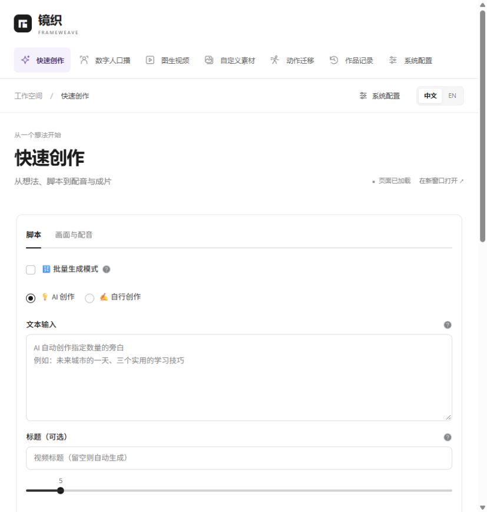

# 纯白工作台与使用反馈优化验收

日期：2026-10-21。目标是在原有功能上优化视觉、表单排版和错误反馈。

<!-- 验收说明：分别记录浏览器观察、离线回归和外部服务边界，不以构建成功代替生成验收。 -->

## 本轮变化

- 工作台与内嵌原表单使用纯白背景、近黑字体、细灰边框、浅紫选中态和统一 SVG 线条图标。保留轻量进入与悬停动效，支持减少动态效果偏好。
- 原七个入口完整保留：快速创作、数字人口播、图生视频、自定义素材、动作迁移、作品记录、系统配置。没有恢复已移除的分镜编辑入口。
- 表单标题、输入框、下拉框、单选框、复选框、滑块、上传区、帮助提示和语义警告统一为浅色样式。配置继续按四类用途分组，媒体提供商分别放在原有子标签内。
- 内嵌表单通过受限来源的布局通知同步自然高度，减少内外双层滚动；通知只包含工具标识和高度。
- ComfyUI 测试携带当前输入的 Bearer 密钥，保留合法反代子路径，分类说明连接、读取超时、认证、路径、网关及响应格式错误。明确查询成功不等于工作流已可运行，测试不保存配置。
- 数字人按页面实际调用阶段反馈错误；视频已经生成但记录或展示失败时单独说明。没有改变服务调用参数，也没有增加自动重试。

依据及后续建议见[上游 Issue 调研](issue-painpoints-2026-10-21.md)。本轮没有把上游未确认的问题当作已查明根因。

## 实际浏览器观察

地址：`http://127.0.0.1:8765/`，在用户现有侧边浏览器窗口完成检查。

- 七个功能逐一打开，原页面正常加载，没有页面脚本异常。
- 快速创作和数字人实际截图确认白色表单、灰阶滑块和可区分的单选/复选状态。
- 系统配置实际页面保留文本模型、图片与视频、工作流、网络与调试四类标签及保存入口。
- 快速创作输入临时标题，切换数字人后再返回，草稿仍保留；检查结束已清空临时标题。
- 右上角中英文切换有效；已经打开的内嵌页面保留草稿，并提示可重新载入以同步语言。检查结束恢复中文。
- 快速创作在当前窗口的内容高度约 1450 px，外层 iframe 高度 1462 px；经过多页面切换后返回仍为 1462 px，没有观察到循环增高。
- 内嵌标签的自动点击受当前浏览器自动化接口限制；其渲染、保存回调与配置隔离通过 AppTest 回归验证，不将离线检查写成浏览器真实服务调用。

## 代码与离线回归

- `python -m pytest tests -q`：**185 passed、197 subtests passed**。11 条既有 `locale.getdefaultlocale` 弃用警告。
- TypeScript 类型检查及 Vite 生产构建通过。
- 本轮前端文件 Prettier 检查、新增诊断 helper / 测试的 Ruff 检查通过。
- 新测试覆盖 ComfyUI Bearer 认证、地址校验、包装后的读取超时、状态分类，以及数字人关键分支阶段归属、不重复调用和页面层异常脱敏。

## 验收边界

- 未调用真实付费生成、未上传人物素材、未修改或保存用户的密钥配置。
- 未验证第三方模型服务可用性，也未重新部署 ComfyUI 或安装模型。
- 数字人 API 客户端内部生成和下载封装为一次调用时，页面仍只能定位到口播视频阶段；独立工作流分支可区分结果下载阶段。
- 本次处理页面层诊断输出，不宣称所有下层服务日志均完成脱敏。
- FFmpeg 当前进程诊断、发布版本整理仍为后续建议；工作流缺失过滤和 TTS 401/403 停止重试属于此前已有保护。
- 8501 独立页面保留原主题；本轮纯白主题限定于 8765 工作台及其内嵌页面。
