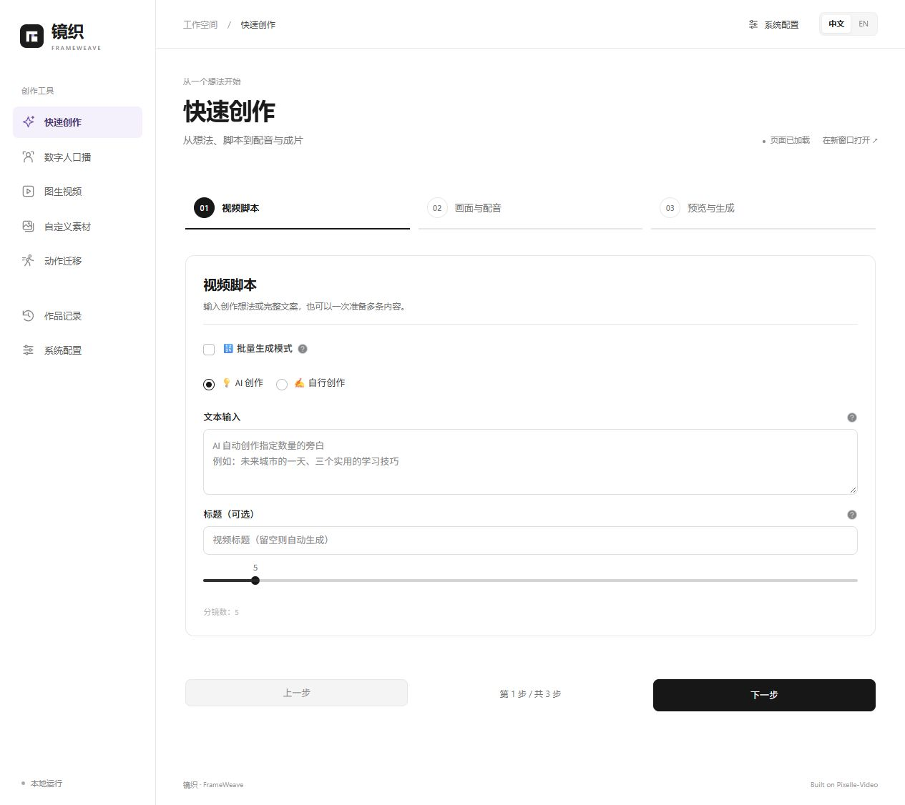

# 镜织 · FrameWeave

<!-- 文档首页以当前产品能力为准；历史工作流资料放在独立参考分组。 -->

**把想法、文案和素材，织成一条完整视频。**

镜织是面向内容创作者、AI 教学博主和个人开发者的本地视频创作工作台。从主题生成脚本与画面，或上传自己的实拍、录屏和图片，让 AI 辅助理解素材、组织旁白，再完成配音、模板排版、背景音乐与视频合成。



## 选择适合的创作方式

| 入口 | 可以完成的事 | 需要准备 |
| --- | --- | --- |
| 快速创作 | 从主题或完整稿件制作短片，或按章节生成 5 / 8 / 10 分钟长片 | 主题或稿件、文本模型和画面 API |
| 数字人口播 | 人物首图配合文案合成的语音，生成口播片段 | 人物图、口播文案、支持参考声音的 API |
| 图生视频 | 让首帧图片按提示词产生运动 | 图片、动作与镜头描述、图生视频 API |
| 自定义素材 | 理解图片与视频，编写旁白，匹配自有素材并合成 | 实拍、录屏或图片，内容方向与讲解要求 |
| 动作迁移 | 组合人物图片与参考动作视频 | 人物图、动作视频、已适配的视频编辑 API |
| 作品记录 | 查看、筛选已有任务和结果 | 已生成记录 |
| 系统配置 | 按用途管理地址、密钥、动态模型目录与代理 | 实际使用的服务配置 |

五个创作页都使用 **内容与素材 → 画面与参数 → 预览与生成** 三步布局。默认中文，右上角切换 English；前后切步和切换已打开的功能页会保留会话输入。刷新或关闭页面仍可能清空草稿。

## 从短片到长视频

快速创作与自定义素材支持 **5 / 8 / 10 分钟**目标。镜织先估算章节、镜头与文案预算，再逐章组织旁白，生成画面或匹配已有素材，最后合成为一条视频。自行创作保留完整原稿，不靠补写或重复原稿凑时长。

自定义素材默认使用原图片与视频；主动开启素材动画才会为匹配到的图片额外调用视频 API。视频在本机按时间抽取最多 8 / 16 / 32 帧交给视觉模型，支持 OpenAI 兼容视觉接口与 DashScope。分析不会识别原音轨，也不能保证找到某个短暂动作。

长视频由多个镜头组合，不改变模型的单次时长上限。目标时长是规划值，完成后会检测实际时长；当前没有整条长片失败后的自动断点续生成。

## 开始使用

1. 阅读[安装指南](getting-started/installation.md)，准备 Python、uv、Node.js、FFmpeg 与 Chromium。
2. 按[模型配置](getting-started/configuration.md)填写实际需要的 API，并加载、保存模型目录。
3. 从[第一个视频](getting-started/quick-start.md)开始，先用少量镜头验证自己的服务。
4. 查看[工作台使用指南](user-guide/web-ui.md)、[常见问题](faq.md)或[故障排查](troubleshooting.md)。

在项目根目录运行：

```bash
# 启动本地工作台及其创作页面服务。
uv run python -m frameweave
```

打开 [http://127.0.0.1:8765](http://127.0.0.1:8765)。工作台面向单用户本地使用；模型生成可能产生服务商费用，启动应用不会自动提交生成。

## 模型能力如何决定

模型名称从已配置接口加载，保存后供创作页选择；不提供目录接口的服务可明确手工维护。图片、视频、数字人和动作迁移还会按已经实现的输入与任务协议筛选。**查询到一个型号，不代表它能完成所有任务。**

配音使用联网 Edge TTS，无需模型密钥。数字人的参考声音能力不等于精确唇形同步；当前 Wan 不保证逐字复现。Grok / Muse 的当前接入用于文生视频与首帧图生视频，不能替代数字人或动作迁移接口。

## 参考与感谢

镜织参考并基于 [Pixelle-Video](https://github.com/ATH-MaaS/Pixelle-Video) 开发，感谢上游贡献。沿用 Apache-2.0，完整版权与第三方声明见仓库的 `LICENSE`、`NOTICE`。
